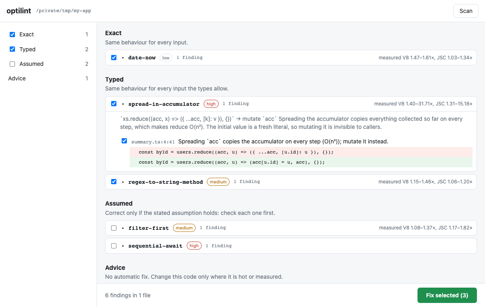

<p align="center"></p>

<h1 align="center">optilint</h1>

<p align="center">Find and fix slow JavaScript and TypeScript.<br>
<a href="https://optilint.pages.dev">Website</a> · <a href="https://optilint.pages.dev/reference">Rules</a> · <a href="https://marketplace.visualstudio.com/items?itemName=TJA.optilint-vscode">VS Code</a> · <a href="https://github.com/tjagithub/optilint-action">GitHub Action</a></p>

A linter for JavaScript and TypeScript that only cares about speed. It finds slow patterns and rewrites them into faster ones: O(n²) accumulators, linear lookups in loops, needless allocations, regexes where a string method would do, sequential awaits.

- **Type-aware:** it uses the TypeScript compiler, so a rule can check that something really is an array before rewriting it.
- **Honest fixes:** every fix says what it guarantees, and `--fix` only applies the safe ones by default.
- **Measured:** every fix is benchmarked on V8 and JavaScriptCore at each compiler tier ([chart](docs/speedups.svg)). Fixes that measured slower don't run.
- **Checked on real code:** on zod v4.6.7, `--fix` at every tier with every rule on (579 edits in 61 files) leaves all 5,482 of its tests passing and its type errors unchanged.

## Usage

No install needed:

```sh
npx @optilint/cli                # report on the current folder (or bunx, pnpm dlx, yarn dlx)
npx @optilint/cli src --diff     # preview fixes
npx @optilint/cli src --fix      # apply exact and typed fixes
npx @optilint/cli --ui           # review in the browser
npx @optilint/cli --init         # write a starter optilint.json
```

To pin a version, add it as a dev dependency (`npm i -D @optilint/cli`); it installs an `optilint` command.

Every fix has a tier:

| Tier | Same behaviour… | Example |
|---|---|---|
| `exact` | for every input | `new Date().getTime()` → `Date.now()` |
| `typed` | for every input the types allow | `xs.filter(f).length > 0` → `xs.some(f)` when `xs: T[]` |
| `assumed` | only if the fix's stated assumption holds | `Promise.all` for sequential awaits |

`--fix` applies `exact` and `typed`; add `--tier assumed` for the rest. `--help` lists every flag, and `--explain <rule>` says why a rule's fix is faster.

## Review in the browser

`--ui` opens a local page that groups findings by tier, shows each fix as a diff with its measured speedup, and applies only the ones you tick.



## Editors and CI

- **VS Code:** the [optilint extension](https://marketplace.visualstudio.com/items?itemName=TJA.optilint-vscode) shows findings as you type, with quick fixes and a sidebar grouped by tier.
- **GitHub Actions:** [optilint-action](https://github.com/tjagithub/optilint-action) annotates findings on the pull request diff.
- **Agents:** `--mcp` runs an MCP server, and `skills/optilint` teaches an agent the tiers.

## Documentation

- [Configuration](docs/configuration.md): `optilint.json`, presets, overrides, disable comments.
- [Rules](docs/rules.md): how fixes are measured, and what is left out on purpose.
- [Editors, CI and agents](docs/integrations.md): JSON, SARIF and GitHub output, and the integrations above.

## Contributing

See [CONTRIBUTING.md](CONTRIBUTING.md) for setup, tests and benchmarks, and how to add a rule.

## License

MIT
